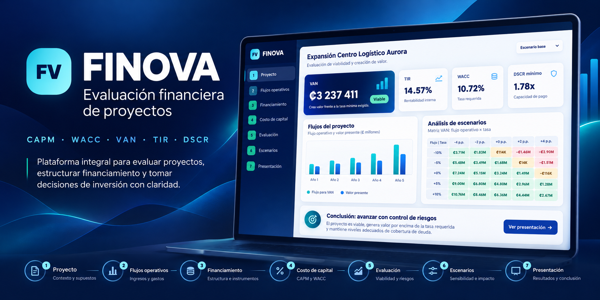
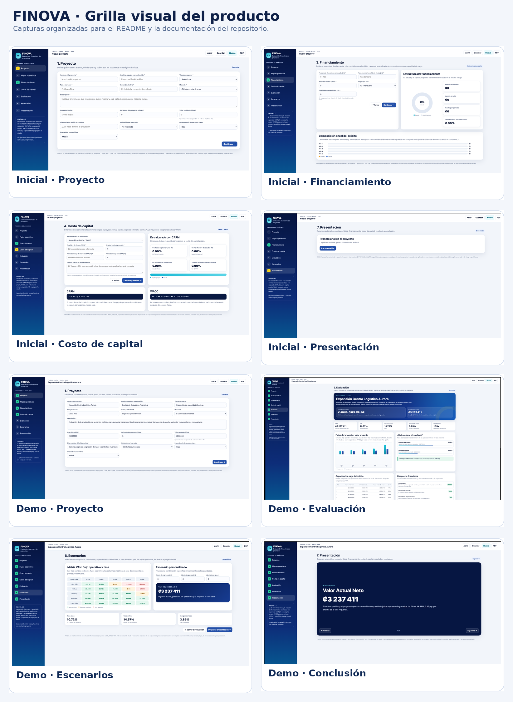
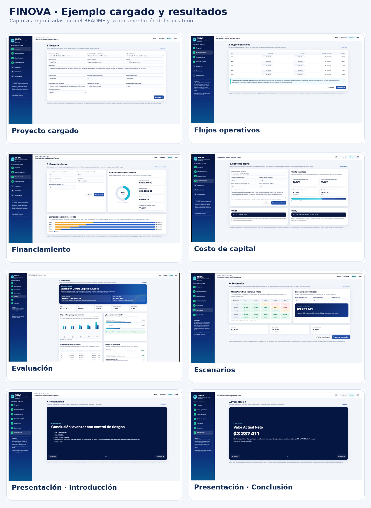
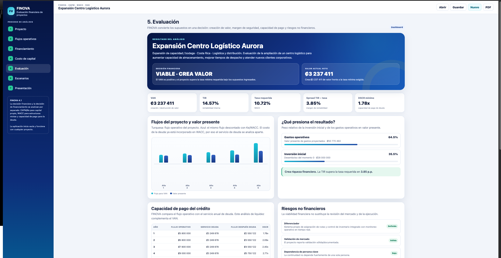
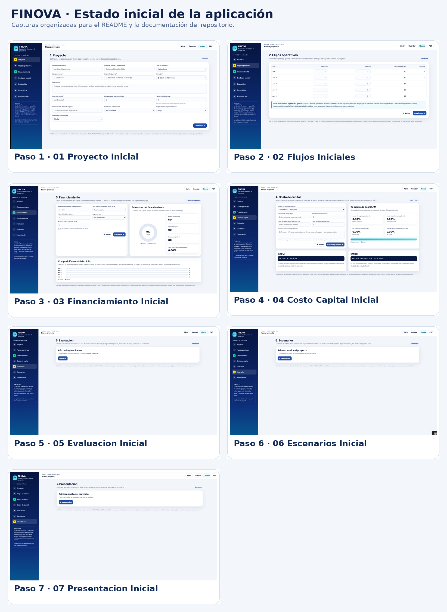
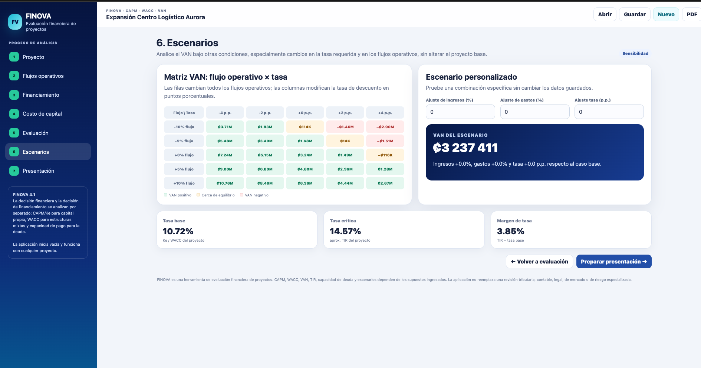
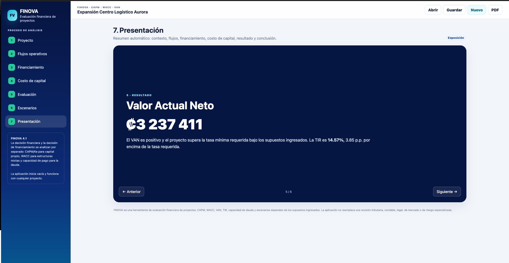

# FINOVA · Evaluación financiera de proyectos

<p align="center">
  
</p>

<p align="center">
  <strong>Aplicación autónoma para evaluar proyectos con CAPM, WACC, VAN, TIR, DSCR, escenarios y presentación ejecutiva.</strong>
</p>

<p align="center">
  
  
  
  
  
</p>

## Descripción

**FINOVA** transforma los supuestos de una inversión en una evaluación financiera clara, auditable y visual.

Integra en un solo flujo:

- definición del proyecto;
- proyección de ingresos y gastos;
- estructura deuda–capital;
- costo de capital mediante **CAPM / Ke** y **WACC**;
- evaluación con **VAN, TIR y payback**;
- capacidad de pago mediante **DSCR**;
- análisis de escenarios;
- riesgos no financieros;
- y una presentación ejecutiva generada automáticamente.

La aplicación principal funciona como un **archivo HTML autónomo**, sin servidor y sin librerías financieras externas. El repositorio también incluye el notebook fuente, documentación visual y un escenario JSON listo para cargar.

---

## Vista general

<p align="center">
  
</p>

### Caso demostrativo cargado

<p align="center">
  
</p>

---

## Flujo de análisis

1. **Proyecto** — contexto, inversión, horizonte, mercado y supuestos estratégicos.
2. **Flujos operativos** — ingresos, gastos y margen por año.
3. **Financiamiento** — deuda, capital propio, tasa, plazo, amortización y escudo fiscal.
4. **Costo de capital** — CAPM / Ke, Kd efectivo y WACC.
5. **Evaluación** — VAN, TIR, tasa requerida, spread, DSCR y lectura ejecutiva.
6. **Escenarios** — sensibilidad del VAN frente a cambios en flujos y tasa de descuento.
7. **Presentación** — resumen ejecutivo automático del análisis.

---

## Métricas y metodología

FINOVA implementa directamente las ecuaciones financieras; no delega los resultados a una librería de finanzas.

### CAPM

```text
Ke = rf + β × ERP + CRP
```

### WACC

```text
WACC = Ke × E/(D+E) + Kd × (1−T) × D/(D+E)
```

### VAN

```text
VAN = −Inversión inicial + Σ Flujo_t / (1+tasa)^t
```

### Cuota nivelada

```text
Cuota = P × i / (1 − (1+i)^(-n))
```

### DSCR

```text
DSCR = Flujo operativo / Servicio de deuda
```

Además, FINOVA calcula TIR mediante búsqueda numérica y mantiene separado el análisis de creación de valor del proyecto y la capacidad de pago de la deuda cuando se utiliza WACC.

---

## Escenario de ejemplo

El repositorio incluye:

`FINOVA_Ejemplo_Centro_Logistico_Aurora.json`

### Expansión Centro Logístico Aurora

**Supuestos principales**

- Inversión inicial: **₡28 000 000**
- Horizonte: **5 años**
- Valor residual: **₡4 000 000**
- Deuda: **45%**
- Capital propio: **55%**
- Tasa nominal de deuda: **10.50%**
- Tasa efectiva anual de deuda: **11.02%**
- Impuesto: **30%**
- Ke: **13.18%**
- WACC: **10.72%**

**Resultados aproximados**

- **VAN:** ₡3 237 411
- **TIR:** 14.57%
- **Spread TIR − WACC:** 3.85 p.p.
- **DSCR mínimo:** 1.78x

<p align="center">
  
</p>

---

## Cómo usar FINOVA

### Ejecutar directamente

1. Descarga o clona el repositorio.
2. Abre `FINOVA_v4.1_Profesional.html` en un navegador moderno.
3. Ingresa tus propios datos o carga un proyecto guardado.

### Abrir el escenario demo

1. Abre FINOVA.
2. Pulsa **Abrir**.
3. Selecciona `FINOVA_Ejemplo_Centro_Logistico_Aurora.json`.
4. Revisa Proyecto, Flujos, Financiamiento y Costo de capital.
5. Pulsa **Calcular y evaluar**.
6. Explora Evaluación, Escenarios y Presentación.

### Regenerar desde Jupyter

Abre `FINOVA_v4.1_Profesional.ipynb` y ejecuta las celdas. El notebook documenta las ecuaciones financieras y genera el HTML autónomo.

---

## Capturas

### Estado inicial

<p align="center">
  
</p>

### Evaluación

<p align="center">
  
</p>

### Escenarios

<p align="center">
  
</p>

### Presentación ejecutiva

<p align="center">
  
</p>

---

## Estructura del repositorio

```text
.
├── FINOVA_v4.1_Profesional.html
├── FINOVA_v4.1_Profesional.ipynb
├── FINOVA_Ejemplo_Centro_Logistico_Aurora.json
├── README.md
├── LICENSE
├── CONTRIBUTING.md
├── SECURITY.md
├── .gitignore
├── archive/
│   └── finova-van-financiamiento-original.zip
└── docs/
    ├── CAMBIOS_FINOVA_v4.md
    └── assets/
        ├── branding/
        │   ├── finova-hero.png
        │   └── finova-social-preview.jpg
        ├── finova-grid-before.png
        ├── finova-grid-demo.png
        ├── finova-grid-overview.png
        └── screenshots/
            ├── before/
            └── after/
```

---

## Tecnologías

- **Python / Jupyter** — auditoría del modelo y generación del HTML.
- **HTML5** — estructura de la aplicación.
- **CSS3** — diseño, dashboard, gráficos y presentación.
- **JavaScript puro** — cálculos financieros, validación, escenarios, gráficos y persistencia de proyectos.
- **JSON** — importación y exportación de escenarios.

No se requieren NumPy, pandas, SciPy, Plotly, React, Flask o servicios externos para ejecutar FINOVA.

---

## Documentación y colaboración

- [Guía de contribución](CONTRIBUTING.md)
- [Política de seguridad](SECURITY.md)
- [Cambios de FINOVA v4](docs/CAMBIOS_FINOVA_v4.md)

---

## Licencia

Este proyecto se distribuye bajo la **MIT License**. Consulta [LICENSE](LICENSE) para los términos completos.

Copyright © 2026 **Juan Ignacio Garbanzo Fallas**.

---

## Aviso

FINOVA es una herramienta de evaluación financiera de proyectos. Los resultados de CAPM, WACC, VAN, TIR, DSCR y escenarios dependen de los supuestos ingresados. No sustituye asesoría financiera, contable, tributaria, legal, de mercado o de riesgo especializada.
